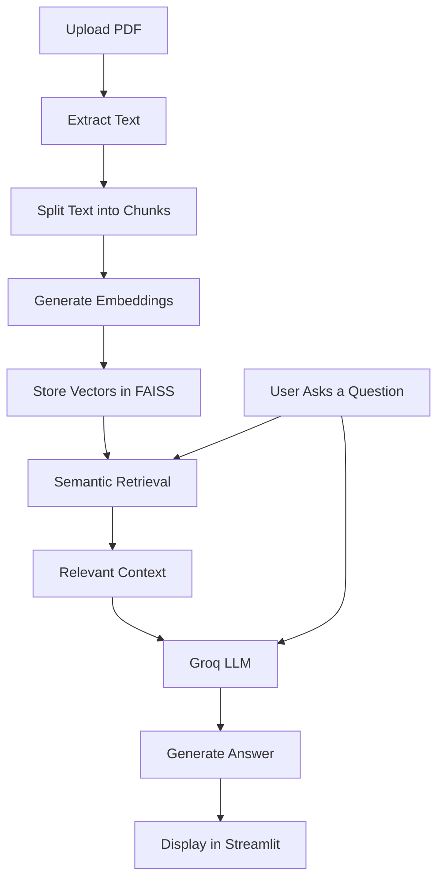

# RagitUP 📄🤖

### Chat with your PDFs using Retrieval-Augmented Generation (RAG)

RagitUP is a lightweight PDF-based AI assistant that allows users to upload a document and ask questions about its contents using natural language. It uses semantic search to retrieve relevant passages from the uploaded PDF and leverages a Large Language Model (LLM) to generate contextual responses.

Built using **Streamlit, LangChain, FAISS, HuggingFace Embeddings, and Groq**, the project demonstrates the fundamentals of building a document-grounded conversational AI application.

---

## ✨ Features

- **PDF Upload:** Upload PDF documents directly through an interactive web interface.
- **Document Text Extraction:** Extract textual content from uploaded PDF pages.
- **Text Chunking:** Break documents into smaller, overlapping chunks for better retrieval.
- **Semantic Search:** Retrieve relevant document content using vector embeddings.
- **AI-Powered Q&A:** Ask natural-language questions and receive contextual answers generated by an LLM.
- **Vector Search:** Uses FAISS for efficient similarity search.
- **Interactive UI:** Simple interface powered by Streamlit.
- **Logging & Error Handling:** Provides application logs and basic error feedback during processing.

---

## 🧠 How It Works

RagitUP follows a basic Retrieval-Augmented Generation (RAG) pipeline.



### Workflow

1. **Upload** — The user uploads a PDF document through the Streamlit interface.
2. **Extraction** — Text is extracted from the document using PyPDF2.
3. **Chunking** — The extracted text is divided into manageable chunks using `RecursiveCharacterTextSplitter`.
4. **Embedding** — Each text chunk is converted into a vector representation using a HuggingFace sentence-transformer model.
5. **Indexing** — The generated embeddings are stored in a FAISS vector store.
6. **Retrieval** — When the user submits a question, relevant document chunks are retrieved through similarity search.
7. **Generation** — The retrieved information is passed into a LangChain QA chain powered by Groq.
8. **Response** — The generated answer is displayed in the application.

---

## 🛠️ Tech Stack

| Technology | Purpose |
|---|---|
| Python | Core programming language |
| Streamlit | Web application interface |
| LangChain | RAG pipeline and LLM orchestration |
| Groq | LLM inference |
| Llama 3.3 70B Versatile | Language model used for answer generation |
| HuggingFace | Text embedding generation |
| Sentence Transformers | Embedding model |
| FAISS | Vector storage and similarity search |
| PyPDF2 | PDF text extraction |
| python-dotenv | Environment variable management |

### Models

**Embedding Model**

`sentence-transformers/all-MiniLM-L6-v2`

Used to transform document chunks into vector embeddings for semantic retrieval.

**LLM**

`llama-3.3-70b-versatile`

Accessed through the Groq API using LangChain's `ChatGroq` integration.

---

## 📂 Project Structure

```text
RagitUP/
│
├── chatbot.py          # Main Streamlit application
├── requirements.txt     # Python dependencies
├── .env               # API credentials (not committed)
└── README.md           # Project documentation
```

---

## 🚀 Getting Started

### Prerequisites

Make sure you have the following installed:

- Python 3.9+
- pip
- A Groq API key

### 1. Clone the repository

```bash
git clone https://github.com/mahidlw2-bit/RagitUP.git
cd RagitUP
```

### 2. Create a virtual environment

**Windows**

```bash
python -m venv venv
venv\Scripts\activate
```

**Linux / macOS**

```bash
python3 -m venv venv
source venv/bin/activate
```

### 3. Install dependencies

```bash
pip install -r requirements.txt
```

### 4. Configure your API key

Create a `.env` file in the root directory:

```env
GROQ_API_KEY=your_groq_api_key_here
```

Replace `your_groq_api_key_here` with your actual Groq API key.

You can obtain an API key from the [Groq Console](https://console.groq.com/keys).

> **Important:** Never commit your `.env` file or expose your API key publicly.

### 5. Run the application

```bash
streamlit run chatbot.py
```

Once the application starts, Streamlit will provide a local URL, typically:

```text
http://localhost:8501
```

Open it in your browser, upload a PDF, and start asking questions.

---

## 📦 Dependencies

The project dependencies are listed in `requirements.txt`.

```text
langchain
langchain-huggingface
langchain-community
langchain-groq
sentence-transformers
pypdf2
faiss-cpu
streamlit
python-dotenv
```

---

## 💡 Example Use Cases

RagitUP can be used as a starting point for document-based AI assistants, including:

- **Research papers:** Ask questions about methodology, findings, and conclusions.
- **Study material:** Summarize chapters or clarify concepts from academic PDFs.
- **Documentation:** Query technical manuals and product documentation.
- **Reports:** Extract insights from business or analytical reports.
- **Personal knowledge:** Interact with notes, guides, and reference documents.

### Example Queries

After uploading a document, try asking:

- *What is the main objective of this document?*
- *Summarize the key findings.*
- *Explain the methodology used.*
- *What are the major conclusions?*
- *What does the document say about a particular topic?*

---

## ⚙️ Configuration

The current application uses the following core settings:

| Parameter | Value |
|---|---|
| Chunk size | 1,000 characters |
| Chunk overlap | 200 characters |
| Embedding model | `all-MiniLM-L6-v2` |
| Vector database | FAISS |
| LLM provider | Groq |
| LLM model | `llama-3.3-70b-versatile` |
| Temperature | 0.1 |
| Maximum retries | 2 |

These settings are defined in the application code and can be modified to experiment with retrieval quality, response generation, and model behavior.

---

## ⚠️ Current Limitations

RagitUP is an experimental project intended to explore the fundamentals of document-based RAG.

- Currently designed around uploaded PDF documents.
- PDF extraction is text-based; scanned documents may require OCR.
- The vector index is created during document processing and is not persisted across application sessions.
- Document processing and embedding generation may take time depending on document size and hardware.
- Answers depend on the quality of extracted text, retrieval relevance, and LLM output.
- The current implementation is a basic document Q&A system and does not provide advanced source citations, multi-document management, or conversation memory.

---

## 🔮 Potential Improvements

Possible future enhancements include:

- [ ] Display retrieved source chunks alongside generated answers.
- [ ] Support multiple PDF documents in a single knowledge base.
- [ ] Add OCR support for scanned PDFs.
- [ ] Persist FAISS indexes for reuse.
- [ ] Implement chat history and conversational memory.
- [ ] Add document-level citations and page references.
- [ ] Improve prompt engineering and hallucination control.
- [ ] Add configurable chunk size and retrieval parameters.
- [ ] Improve UI/UX with chat-style interactions.
- [ ] Add document preview and page-level navigation.
- [ ] Dockerize the application for easier deployment.

---

## 🔐 Security

- Store API credentials in environment variables.
- Avoid hardcoding API keys in source code.
- Do not commit `.env` files to version control.
- Be mindful of sensitive documents when using external LLM APIs, as retrieved content is sent to the model provider for inference.

---

## 👨‍💻 Author

**Mahi**

Created as a hands-on exploration of Retrieval-Augmented Generation, semantic search, vector databases, and LLM-powered document interaction.

---

## 📄 License

No license has been specified yet. Please contact the repository owner before reusing or redistributing this project.

---

*Built with Python, LangChain, Streamlit & Groq.*
